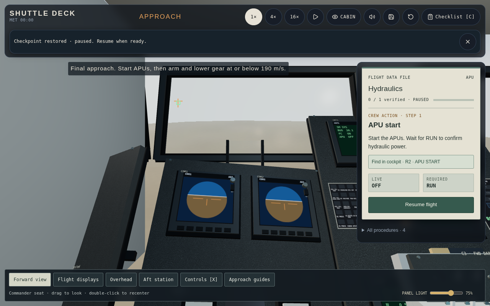
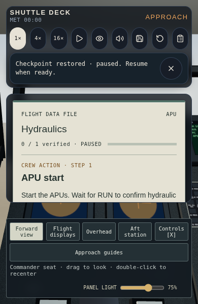

# Checkpoint recovery

The interrupted walkthrough must resume with a coherent cabin, outside view
and checklist. The pre-change v3 packet stored root flight state and view
preferences but omitted the deck's geodetic origin, runway anchor and verified
procedure history. The controls packet stored breakers but omitted persistent
switch commands. Restore also left a fresh adapter stopped on the menu and
retained later physical/analog inputs and procedure latches.

An owner-backed reproduction saved the initial final-approach scenario at
approximately `x=-11000 m, y=1980 m, z=0`. Restoring after starting entry instead
showed `x=-2089683 m, z=400750 m` and no landing anchor. A fresh adapter showed
`x=-8984880 m, z=3183737 m`, also without an anchor, and `running=false`.
These were render/recovery faults, not root trajectory changes.

## Recovered behavior

The additive v3 fields persist the deck frame, fixed landing anchor, seen
callouts and verified procedure latches. Root controls save explicit persistent
switch commands. An untouched channel still uses its owner's defaults;
recording it as OFF would incorrectly shut down the initially powered fuel
cells. Root systems remain the vehicle truth.

Restore validates the envelope and asks the root owner to restore the vehicle
before committing view/preferences. An owner exception rolls back to the
trusted current snapshot and pause state. Successful recovery starts the
adapter, replaces future checklist history with saved history and pauses the
flight. The checklist reopens, inspection clears, and the optional Controls
drawer closes. Recovery resets the checklist scroll and collapses its overview,
including when restoring the same step. Resume is a deliberate crew action.

Held OMS burn, hand controls, momentary switches and buttons are released.
APU START/RUN and bay-door direction are persistent commands, so their restored
spool/transit continues after Resume. Electrical contactor latches and breaker
positions retain their existing owner/registry restoration.

Save/Restore buttons are available in the header, including on phones and the
preflight menu. F5/F9 take priority over a focused native range input. Feedback
reports missing, unreadable, incompatible or blocked-storage saves. Success
messages dismiss after six wall-clock seconds; errors remain dismissible.
There is one browser-local save, replaced by Save.

## Evidence

- `npm test`: owner-backed frame/cold recovery, persistent commands, input
  release, checklist rewind and saved history, rejected packets, legacy saves
  and storage failures, plus existing web checks.
- Root `tests/procedures.test.ts`: switch persistence and held-command release
  alongside contactor and breaker recovery; `tests/systems.test.ts` covers
  existing mechanisms and checkpoint compatibility.
- `tests/checkpoint-browser.py`: real GUI/keyboard recovery across scenarios
  and page reloads, paused desktop/390-pixel portrait layouts, focused F5/F9,
  mechanism continuity, saved checklist history, burn release and error paths.
  Only the existing probe advances time; it does not assign vehicle truth.
- Existing cockpit, landing and walkthrough browser regressions exercise
  scene controls, layout, entry handoff and wheel stop around this change.

Production review captures:

## Limits

Older v3 saves cannot recover information they never recorded. They restore
paused with a warning, using the known scenario origin and regenerating a
missing terminal anchor. Crew must verify and configure switches/checklist
before resuming. This is compatibility recovery, not exact reconstruction of
an older saved view or lost historical verification.

This pass changes control persistence and browser presentation. It does not
change guidance/dynamics laws, mechanism timings, mission data or historical
cockpit fidelity. The selected target remains Columbia on STS-1 (1981); the
current cabin still uses later MEDS displays. Historical panel conversion needs
primary reference evidence and fixed-camera acceptance. The existing root
electrical TypeScript diagnostics and build chunk-size warning remain.
